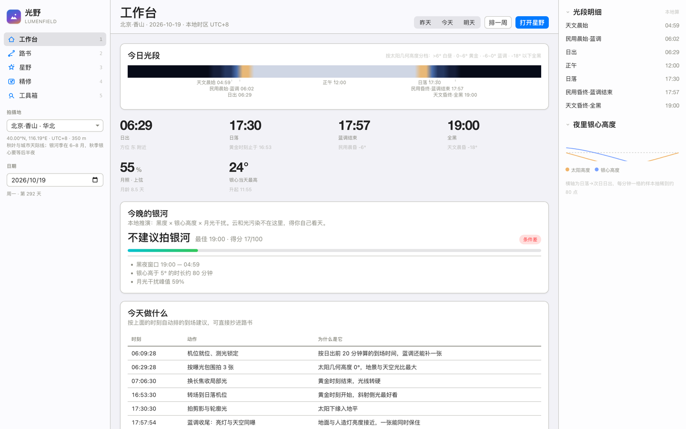
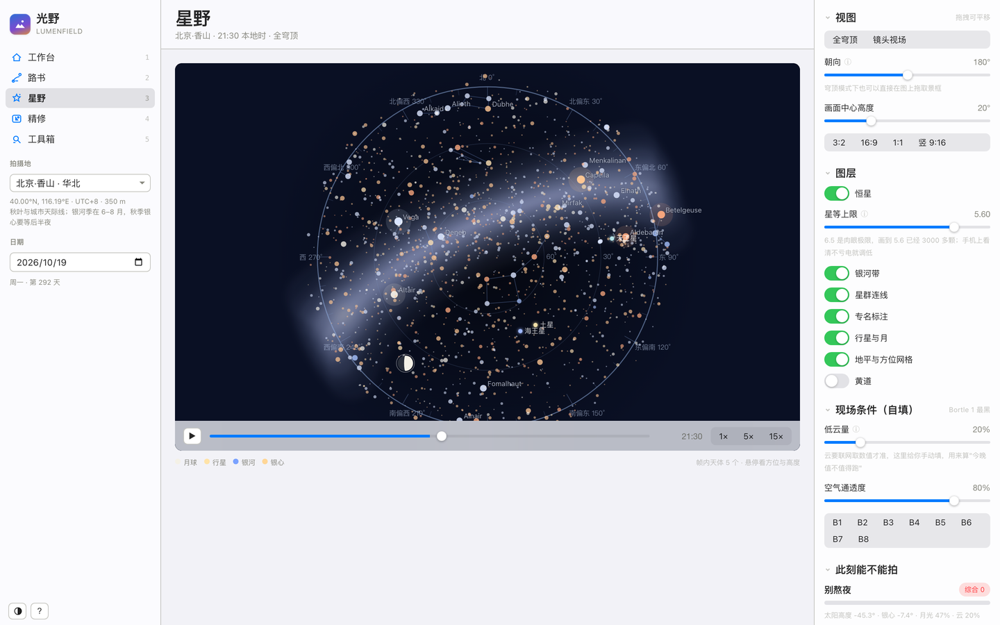
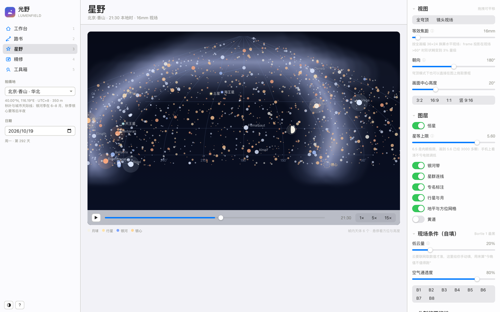
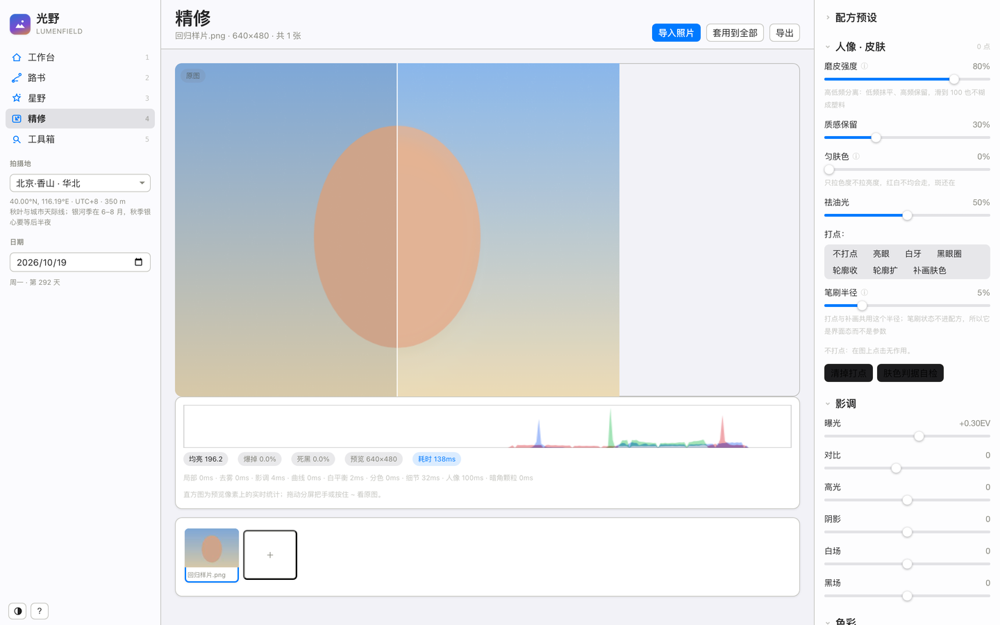
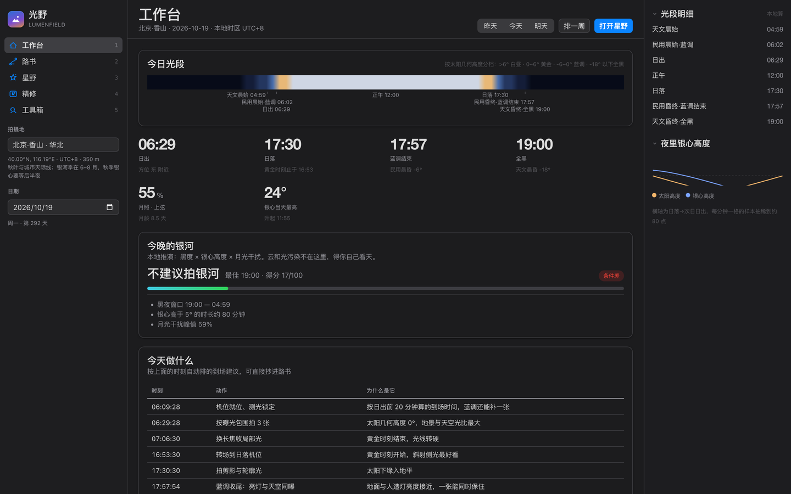
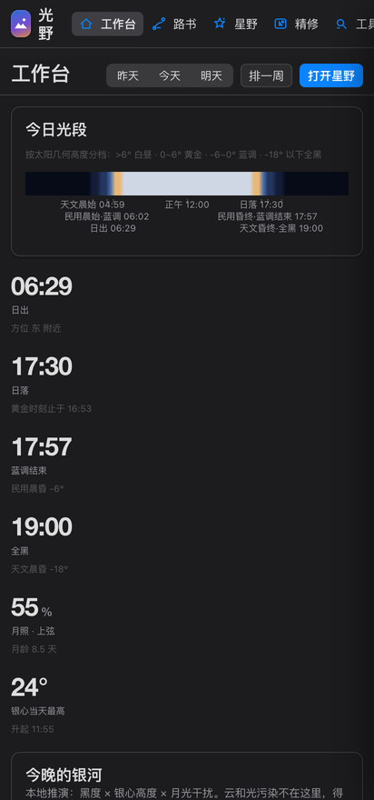
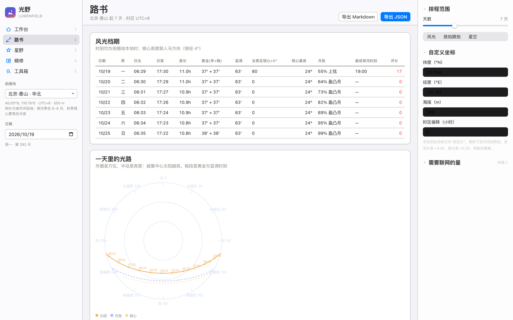

# 光野 LumenField

风光与旅拍的一体化本地工作台：出门前排路书，夜里推星野，回来做精修。照片不出这台机器。



| 星野·全穹顶 | 星野·镜头视场 | 精修（左原图右效果） |
| --- | --- | --- |
|  |  |  |

| 深色模式 | 手机（412px） | 路书 |
| --- | --- | --- |
|  |  |  |

## 30 秒跑起来

| 方式 | 怎么做 |
| --- | --- |
| 最省事 | 双击 `index.html`。没有构建、没有依赖安装、没有 npm install。 |
| 想要完整能力 | `python3 -m http.server 8795` 后打开 <http://127.0.0.1:8795/>（`file://` 下浏览器禁本地 `fetch`，本仓库刻意不用 fetch，两种打开方式都能跑；但 http 下 localStorage 更稳） |
| 在线看 | <https://harv1y-1314.github.io/lumenfield/>（GitHub Pages，与本仓库同源，改动 push 后约 1 分钟生效） |

需要 Safari 16 / Chrome 110 以上的任意桌面浏览器；iPhone 与 iPad 直接用 Safari 打开同一地址即可。

## 四个工作区

| 工作区 | 解决什么 | 关键产出 |
| --- | --- | --- |
| 工作台 | 今天到底几点到场、要不要熬夜 | 光段条、六个关键时刻、"今晚的银河"评分、到场建议清单 |
| 路书 | 一段行程里哪天值得拍什么 | 3–14 天的日出日落/黄金/蓝调/全黑/银心高度/月相/评分表，光路罗盘，一键导出 Markdown 与 JSON |
| 星野 | 银河和星体在什么位置、能不能装进我的镜头 | 全穹顶与镜头视场两种投影，时间轴可播放（1×/5×/15×），3249 颗亮星 + 银河带 + 银心 + 行星 + 月相，拖拽改朝向，悬停查方位高度 |
| 精修 | 人像与风光的后期，且要能回到 Lightroom | 高低频磨皮、匀肤、祛油光、打点（亮眼/白牙/黑眼圈/轮廓微调）、暗通道去雾、清晰度纹理、8 段 HSL、分离色调、控制点局部光、一键水平、透视、配方 JSON、`.cube` 3D LUT 导出 |
| 工具箱 | 现场要按的几个计算器 | 500 与诺兰法则对照、星轨张数、超焦距、朔望与无月窗口、光段倒计时、本站银河季 |

## 与像素蛋糕的差异

像素蛋糕（pixcakeai.com）是这条赛道上做得最完整的产品，我们把它的功能面逐项拆过（见 [docs/像素蛋糕拆解.md](docs/像素蛋糕拆解.md)），然后刻意选了另一条路：

| 维度 | 像素蛋糕 | 光野 |
| --- | --- | --- |
| 照片去哪 | 端上推理为主，创意类工具上云排队扣点 | 全前端像素运算，不发一个请求 |
| 计费 | 按成功导出张数计费，额度一年作废 | 无账号无计费 |
| 生态 | 导入 `.xmp` 与 `.cube` | 反向导出 `.cube`（33³/17³），色彩链能带回 Lightroom / Capture One |
| 场景 | 人像精修为绝对主场 | 人像 + 风光 + 前期时空推演一体，风光与星空是主战场 |
| 可解释 | 功能置灰时原因藏在帮助文档里 | 每个数标口径；算不出来的（云量、光污染、视宁度）在界面上明确留白 |

不做的也写清楚：没有语义分割网络，所以"面部皮肤/眉毛/眼瞳/嘴唇/牙齿"这类自动分区我们只做**判据 + 手动补画**；没有 RAW 解码，输入是 JPEG/PNG/WebP；不做换天、生成式消除与 AI 布景。

## 算法与核对

历算核心是 Schlyter 轨道要素 + Meeus 简化恒星时，影像核心是纯手写像素算子。两者都做了外部对照，不是"看起来对"：

| 核对 | 参照 | 实测最大偏差 |
| --- | --- | --- |
| 太阳/月球/五行星视位置 | JPL DE440s（Skyfield 读取） | 位置 0.040°，高度 0.024°，方位 0.045° |
| 日出日落与三段晨昏蒙影 | DE440s 求根 + api.sunrise-sunset.org（NOAA 算法） | 71.7 秒（4 个纬度带，含极夜与高纬） |
| 月出月落 | DE440s 求根 | 秒级 |
| 朔与望 | DE440s `moon_phases` | 416 秒 |
| 银道坐标 | Yale BSC5 表内 `GLON/GLAT` 抽 1200 颗 | 银经 0.165°、银纬 0.033°（表值只给两位小数） |
| 磨皮 | 合成噪声图 + 硬边 | 平涂区噪声标准差降到 0.24，硬边梯度保留 0.90 |
| 去雾 | 人造雾（已知透射率与大气光） | 与无雾原图 RMSE 比 0.45 |
| `.cube` 与预览一致性 | 同参数走整条链路逐色比对 | 偏差 0.0000 |

跑一遍：

```bash
node tests/astro.test.mjs      # 历算 330 项
node tests/imaging.test.mjs    # 影像算子 52 项
bash tools/check.sh            # 上面两项 + 全量语法检查 + 发布前自检
```

完整数字与失败记录在 [docs/验证记录.md](docs/验证记录.md)，里面也记了这轮开发中被测试抓出来的 9 个真 bug（行星距角用了日心黄经、HSL 带宽判据反了、星表步长取成 `undefined` 等）。

## 目录

```
index.html              单页入口，无构建
assets/css/tokens.css   Apple HIG 数值令牌（含明暗两套系统色）
assets/css/app.css      结构与状态样式
src/core/astro.js       历算：太阳/月球/行星/晨昏/银道/岁差/折射/升落求根
src/core/imaging.js     影像算子与固定顺序的渲染链路
src/core/skymap.js      星图投影与绘制（穹顶、镜头视场）
src/data/stars.js       3249 颗亮星（自动生成）
src/data/asterisms.js   手写星群连线，端点必须能在星表里落到具体恒星
src/data/sites.js       40 个拍摄地预设 + 经纬度自检
src/ui/                 外壳与五个视图
tools/build-stars.js    星表生成器（含连线端点校验）
tools/reference/        DE440s 取样脚本，重新生成 tests/fixtures/de440s.json
tests/                  离线核对套件
```

## 数据来源与许可

- 代码：MIT，见 [LICENSE](LICENSE)。
- 恒星表：Yale Bright Star Catalogue 第 5 版（brettonw 整理的 JSON，MIT），见 `tools/vendor/` 内许可原文。
- 轨道要素与摄动项：Paul Schlyter 的公开教程 *How to compute the orbital positions of Sun, Moon and planets*。
- 银道常数：IAU 1958 银道系（银极 192.85948°/+27.12825°，银心 266.4051°/−28.9362°）。
- 界面数值：Apple Human Interface Guidelines 的 Typography / Color / Materials / Dark Mode / Layout / Motion 六页；HIG 未给数字的材质模糊与动效时长在 `tokens.css` 注释里标为经验值。
- 外部历表参照件 `de440s.bsp` 由 NASA JPL 发布，不随本仓库分发。

详见 [docs/数据来源与许可.md](docs/数据来源与许可.md)。
